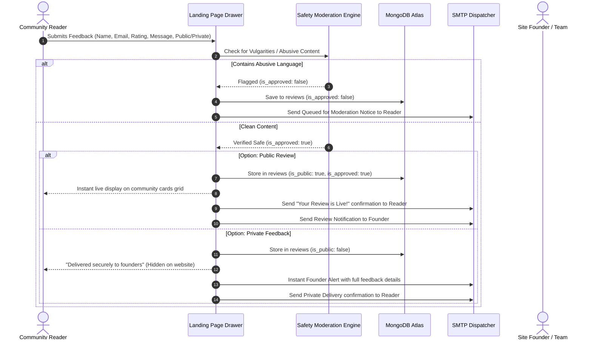

<div align="center">

# ⚡ Synapse AI — Autonomous Frontier AI Intelligence Engine

[](https://www.python.org/)
[](https://www.mongodb.com/atlas)
[](https://groq.com/)
[](https://fastapi.tiangolo.com/)
[](https://vercel.com/)
[](.github/workflows/ci.yml)
[](LICENSE)

<p align="center">
  <a href="https://ai-news-aggregator-master-omega.vercel.app/">
    
  </a>
</p>
<p align="center">
  🌐 <b>Live Web Application:</b> <a href="https://ai-news-aggregator-master-omega.vercel.app/">https://ai-news-aggregator-master-omega.vercel.app/</a>
</p>

<p align="center">
  <b>An autonomous research intelligence pipeline that crawls arXiv preprints, AI laboratory disclosures, and technical talks, clusters duplicate coverage, synthesizes 2-minute architectural briefings using Groq LLMs, and delivers briefings directly via high-deliverability email reports and a modern dark-mode landing page.</b>
</p>

[Key Capabilities](#-key-capabilities) • [System Architecture](#-system-architecture) • [Smart Reviews & Moderation](#-smart-reviews--community-feedback) • [Quick Start](#-quick-start) • [Vercel Deployment](#-1-click-vercel-deployment) • [API & Telemetry](#-rest-api--telemetry-endpoints) • [Testing](#-running-tests)

---

</div>

## 📌 Table of Contents

- [🌟 Overview](#-overview)
- [✨ Key Capabilities](#-key-capabilities)
- [🏗️ System Architecture](#-system-architecture)
- [💬 Smart Reviews & Feedback Pipeline](#-smart-reviews--community-feedback)
- [📡 Primary Sources Monitored](#-primary-sources-monitored)
- [🚀 Quick Start](#-quick-start)
  - [Prerequisites](#prerequisites)
  - [Local Setup](#local-setup)
  - [Configuration (.env)](#configuration-env)
  - [Running the CLI Pipeline](#running-the-cli-pipeline)
  - [Running the Web Server](#running-the-web-server)
- [☁️ 1-Click Vercel Deployment](#-1-click-vercel-deployment)
- [🌐 REST API & Telemetry Endpoints](#-rest-api--telemetry-endpoints)
- [🐳 Docker Deployment](#-docker-deployment)
- [📁 Project Directory Layout](#-project-directory-layout)
- [🧪 Running Tests](#-running-tests)
- [🗺️ Project Roadmap](#-project-roadmap)
- [📜 License](#-license)

---

## 🌟 Overview

Artificial Intelligence moves at an overwhelming pace. Every morning brings dozens of new preprints to **arXiv**, breaking model weights from **OpenAI**, **Anthropic**, and **Hugging Face**, technical post-mortems, and conference keynotes. For researchers, founders, and engineers, tracking primary sources manually requires hours of scrolling.

**Synapse AI** functions as an autonomous, multi-agent intelligence pipeline:
1. **Autonomous Crawling**: Ingests primary papers, lab announcements, and video seminar transcripts.
2. **Semantic Deduplication**: Uses TF-IDF cosine similarity vector clustering to merge duplicate news across outlets into a single canonical story.
3. **Neural Synthesis**: Distills dense preprints into 3 core architectural takeaways, benchmark shifts, and verified paper links using Groq's high-speed `llama-3.3-70b-versatile`.
4. **Zero-Hype Delivery**: Delivers a curated, 2-minute briefing every morning at 8:00 AM with zero tracking pixels, no passwords, and instant 1-click unsubscribe.
5. **Community Engagement**: Features an interactive review drawer with automated safety moderation, public testimonials, and private founder feedback routing.

---

## ✨ Key Capabilities

| Capability | Technical Details |
| :--- | :--- |
| ⚡ **Groq Ultra-Fast LPU Synthesis** | Powered by `llama-3.3-70b-versatile` for instantaneous paper distillation, methodology analysis, and key benchmark extraction. |
| 🛡️ **Autonomous Backup Summarizer** | Algorithmic NLP extractive heuristics that seamlessly activate if Groq LLM is offline or out of tokens, ensuring zero pipeline halts. |
| 🍃 **Pure MongoDB Atlas Storage** | 100% cloud persistence for subscribers, research digests, community reviews, and email audit telemetry. |
| 📡 **Live Intelligence Feed & Search** | Interactive front-end stream with instant keyword search (`/` shortcut) and source filters for arXiv, OpenAI, Anthropic, and Hugging Face. |
| 🔊 **Web Speech Audio Briefings** | In-browser 60-second audio recap player for every synthesized paper and model release. |
| 🔖 **Offline LocalStorage Bookmarks** | Readers can bookmark papers without an account and view them in a dedicated drawer. |
| 📋 **BibTeX Citation Generator** | 1-click BibTeX citation generation for arXiv preprints for rapid academic referencing. |
| 📬 **RFC 8058 Inbox Deliverability** | Includes `List-Unsubscribe: One-Click` headers and DNS MX record validation to bypass Gmail Spam filters. |
| ☕ **Buy Me a Coffee (UPI + QR)** | Interactive donation drawer supporting mobile auto-UPI apps (GPay/PhonePe/Paytm) and desktop live QR codes. |
| ⏰ **24/7 GitHub Actions Cron** | Automated daily scheduler running at 8:00 AM IST (`cron: '30 2 * * *'`) for unattended scraping and newsletter dispatches. |
| 🎨 **Minimalist Dark Aesthetic** | Hand-crafted landing page designed with clean typography (Archivo), animated hero fold, dynamic source ticker, and responsive review cards. |
| 💬 **Public vs. Private Feedback** | Interactive 5-star review drawer supporting **Public Reviews** (shown on site) and **Private Feedback** (emailed directly to founders). |
| 📊 **Real-Time Audit Telemetry** | Full audit tracking stored in MongoDB `email_logs` and accessible via live diagnostic endpoints (`/api/logs/emails`, `/api/test-email`). |
| ☁️ **1-Click Vercel Serverless Ready** | Native ASGI `main:app` zero-config routing with `vercel.json` rewrites and ~35 MB lightweight bundle footprint. |

---

## 🏗️ System Architecture

```mermaid
flowchart TD
    subgraph Ingestion ["1. Data Ingestion Layer"]
        S_ARX["arXiv cs.AI Papers"]
        S_OAI["OpenAI Research RSS"]
        S_ANT["Anthropic Announcements"]
        S_HF["Hugging Face Daily Papers"]
        S_TC["TechCrunch AI Feed"]
        S_YT["YouTube AI Seminars"]
    end

    subgraph Normalization ["2. Normalization & Filtering"]
        Parser["HTML / RSS Parser & Cleaner"]
        TimeFilter["24h Time Window Filter"]
        Cluster["Semantic Deduplication & TF-IDF Clustering"]
    end

    subgraph Intelligence ["3. Neural Synthesis Engine (Groq LPU)"]
        LLM["Llama 3.3 70B Versatile"]
        Curator["Relevance Scorer & Takeaway Distiller"]
        EmailGen["Newsletter & Executive Brief Generator"]
    end

    subgraph Persistence ["4. Cloud Database (MongoDB Atlas)"]
        DB_Sub[("subscribers")]
        DB_Dig[("digests")]
        DB_Rev[("reviews")]
        DB_Log[("email_logs")]
    end

    subgraph Distribution ["5. User Interface & Distribution"]
        WebUI["SaaS Landing Page (FastAPI)"]
        SMTP["Gmail SMTP Dispatcher (8:00 AM)"]
        Webhooks["Slack / Discord Webhooks"]
        API["Public Telemetry API (/api)"]
    end

    Ingestion --> Parser
    Parser --> TimeFilter
    TimeFilter --> Cluster
    Cluster --> LLM
    LLM --> Curator
    Curator --> EmailGen
    EmailGen --> Persistence
    Persistence --> Distribution
```



---

## 💬 Smart Reviews & Community Feedback

Synapse AI includes a community feedback system designed with privacy and safety controls:



> [!NOTE]
> **Privacy Guarantee**: Reviewer emails are strictly stripped from all public API projections (`{"_id": 0, "email": 0}`). Only names, roles, star ratings, and review comments are publicly visible.

---

## 📡 Primary Sources Monitored

| Source | Category | Ingestion Method | Cadence |
| :--- | :--- | :--- | :--- |
| **arXiv cs.AI** | Peer-Reviewed Research | Atom / XML Preprints | Real-time |
| **OpenAI Research** | Frontier Lab Disclosures | RSS XML Feed | Daily |
| **Anthropic News** | Lab Updates & Releases | RSS XML Feed | Daily |
| **Hugging Face** | Open Source Weights & Models | Blog & Paper Feeds | Real-time |
| **TechCrunch AI** | Industry & Venture Coverage | RSS Feed | Hourly |
| **YouTube AI Seminars** | Technical Talks & Keynotes | Transcript Extraction API | Daily |

---

## 🚀 Quick Start

### Prerequisites
- Python 3.11+
- [Groq API Key](https://console.groq.com/) (Free inference key)
- [MongoDB Atlas Connection String](https://cloud.mongodb.com/) (Free M0 cluster)
- Google App Password (for Gmail SMTP dispatch)

### Local Setup

```bash
# 1. Clone the repository
git clone https://github.com/Chaitanya23145/ai-news-aggregator-master.git
cd ai-news-aggregator-master

# 2. Create and activate a virtual environment
python3 -m venv env
source env/bin/activate  # On Windows: env\Scripts\activate

# 3. Install lightweight production dependencies (~35 MB)
pip install -r requirements.txt
```

### Configuration (.env)

Create a `.env` file in the project root:

```env
# Groq High-Speed Inference
GROQ_API_KEY=gsk_your_groq_api_key_here
GROQ_MODEL=llama-3.3-70b-versatile

# Pure MongoDB Atlas Cloud Database
DB_TYPE=mongodb
MONGODB_URI=mongodb+srv://<username>:<password>@cluster0.your_cluster.mongodb.net/?appName=Cluster0
MONGODB_DB_NAME=ai_news_aggregator

# Automated Email Service (Gmail SMTP)
EMAIL_ENABLED=true
MY_EMAIL=your_email@gmail.com
APP_PASSWORD=your_16_char_gmail_app_password
SMTP_HOST=smtp.gmail.com
SMTP_PORT=465
```

### Running the CLI Pipeline

Ingest and synthesize research from the last 24 hours into a local markdown brief:

```bash
python main.py
# Or custom parameters: python main.py <hours> <top_n>
python main.py 48 15
```

### Running the Web Server

Launch the web application with live reload:

```bash
python main.py web 8000
# Or directly via Uvicorn:
uvicorn main:app --reload --port 8000
```

Open **`http://localhost:8000`** in your browser.

---

## ☁️ 1-Click Vercel Deployment

Synapse AI is optimized for native serverless execution on **Vercel**:

1. Push your repository to **GitHub**.
2. Go to [Vercel Dashboard](https://vercel.com/new) $\rightarrow$ **Import Git Repository**.
3. Configure Project Settings:
   - **Framework Preset**: `FastAPI` (or `Other`)
   - **Root Directory**: `./`
4. Expand **Environment Variables** $\rightarrow$ Click **"or paste the .env contents"** and paste your `.env`:
   ```env
   GROQ_API_KEY=gsk_...
   GROQ_MODEL=llama-3.3-70b-versatile
   DB_TYPE=mongodb
   MONGODB_URI=mongodb+srv://...
   MONGODB_DB_NAME=ai_news_aggregator
   EMAIL_ENABLED=true
   MY_EMAIL=your_email@gmail.com
   APP_PASSWORD=your_app_password
   SMTP_HOST=smtp.gmail.com
   SMTP_PORT=465
   ```
5. Click **Deploy**! Vercel natively packages `main:app` in seconds without build size issues.

---

## 🌐 REST API & Telemetry Endpoints

| Method | Endpoint | Description |
| :--- | :--- | :--- |
| `GET` | `/` | Serves the modern Synapse AI dark-mode single-page frontend |
| `POST` | `/api/subscribe` | 1-Click subscriber enrollment + instant confirmation email |
| `GET` | `/api/reviews` | Returns all approved community reviews (sanitized, emails hidden) |
| `POST` | `/api/reviews` | Submits feedback with safety moderation & public/private routing |
| `GET` | `/api/logs/emails` | Diagnostics endpoint: returns real-time email delivery audit trail |
| `GET` | `/api/test-email` | Live diagnostic: sends a test SMTP handshake ping to verify credentials |
| `GET` | `/api/health` | Service health telemetry and active scraper pipeline status |
| `GET` | `/api/stats` | Real-time public telemetry (total digests, subscriber count) |
| `GET` | `/api/digests` | Returns paginated distilled research briefs |
| `POST` | `/api/alerts/test` | Triggers a test alert to configured Slack/Discord webhooks |

---

## 🐳 Docker Deployment

Run the complete containerized stack:

```bash
# Build and run the container
docker compose up -d

# Check live logs
docker compose logs -f
```

Accessible at `http://localhost:8000`.

---

## 📁 Project Directory Layout

```
ai-news-aggregator/
├── .github/
│   └── workflows/
│       └── ci.yml               # GitHub Actions CI matrix (Py 3.11 & 3.12)
├── app/
│   ├── agent/                   # Groq LLM Agent Prompts & Synthesis
│   │   ├── curator_agent.py     # Article relevance scoring & ranking
│   │   ├── digest_agent.py      # Abstract synthesis & key takeaways
│   │   └── email_agent.py       # Newsletter formatting & executive brief
│   ├── database/                # Persistence & Cloud Data Access
│   │   ├── connection.py        # MongoDB Atlas client & SQLite CI fallback
│   │   ├── models.py            # Relational models & schemas
│   │   └── repository.py        # MongoDB Atlas queries & review storage
│   ├── scrapers/                # Primary Ingestion Crawlers
│   │   ├── anthropic.py         # Anthropic RSS scraper
│   │   ├── arxiv_ai.py          # arXiv cs.AI research crawler
│   │   ├── huggingface.py       # Hugging Face daily papers crawler
│   │   ├── openai.py            # OpenAI newsroom crawler
│   │   ├── techcrunch.py        # TechCrunch AI crawler
│   │   └── youtube.py           # YouTube video & transcript crawler
│   ├── services/                # Pipeline & Infrastructure Services
│   │   ├── email.py             # Dual-port SMTP engine & email logging
│   │   ├── moderation.py        # Content safety & vulgarity filter
│   │   ├── vector_clustering.py # TF-IDF & Cosine semantic clustering
│   │   ├── webhook_alerts.py    # Slack & Discord webhook dispatcher
│   │   └── demo_data.py         # Seed data generators
│   ├── templates/
│   │   └── dashboard.html       # Minimalist Archivo dark landing page & reviews UI
│   ├── api.py                   # FastAPI application & REST routing
│   ├── config.py                # Central pipeline configuration
│   ├── daily_runner.py          # 8:00 AM master pipeline runner
│   └── runner.py                # Multi-source scraper orchestrator
├── output/                      # Markdown digest archive
├── tests/
│   └── test_pipeline.py         # 13/13 passing unit & integration tests
├── .env.example                 # Environment configuration template
├── .vercelignore                # Vercel bundle optimization exclusions
├── Dockerfile                   # Production container definition
├── index.py                     # Root serverless adapter
├── main.py                      # Master CLI & FastAPI server entrypoint
├── pyproject.toml               # Native Vercel entrypoint declaration
├── requirements.txt             # Lightweight production dependencies (~35 MB)
└── README.md                    # Project documentation
```

---

## 🧪 Running Tests

Run the complete unit and integration test suite:

```bash
# Run tests against live database or isolated fallback
python -m unittest tests/test_pipeline.py
```

All 13 test suites pass across Python 3.11 and 3.12 in both cloud and headless environments:
- ✅ Database fallback & ORM schema instantiation
- ✅ User authentication & password hashing
- ✅ Scraper normalization & content cleaning
- ✅ Semantic vector clustering
- ✅ Markdown digest generation

---

## 🗺️ Project Roadmap

- [x] Multi-source ingestion (OpenAI, Anthropic, HuggingFace, TechCrunch, arXiv, YouTube)
- [x] Groq ultra-low-latency LPU synthesis (`llama-3.3-70b-versatile`)
- [x] Pure MongoDB Atlas cloud migration
- [x] Interactive community review & 5-star feedback drawer
- [x] Automated content safety & vulgarity moderation filter (English & Hinglish)
- [x] Dual-port SMTP dispatch (`Port 465 SSL` $\rightarrow$ `Port 587 STARTTLS`)
- [x] Real-time email delivery audit logging in MongoDB Atlas
- [x] Live diagnostic telemetry endpoints (`/api/logs/emails`, `/api/test-email`)
- [x] Zero-config Vercel Serverless deployment with native `main:app` routing
- [x] Isolated fallback schema for seamless GitHub Actions CI execution

---

## 📜 License

Distributed under the **MIT License**. See [LICENSE](LICENSE) for full details.

---

<div align="center">
  <b>Built with ⚡ high-speed neural intelligence by Chaitanya Upadhyay</b>
</div>
